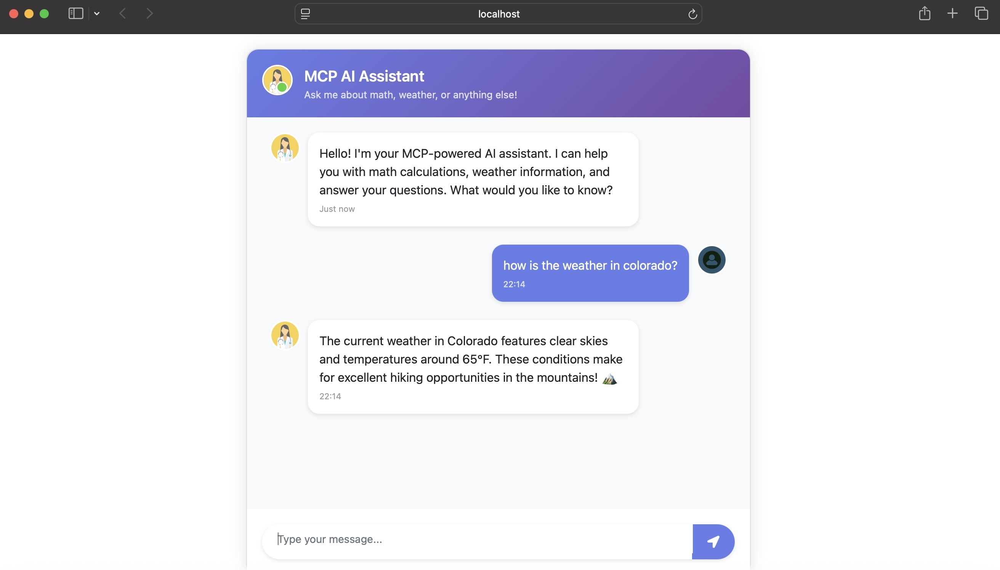

My featured projects are on the [homepage](/). This page gives more detail on my industry work and the other systems I have built.

## Industry Experience

*Junior Software Engineer, Tirzok Private Ltd., Dhaka · Feb 2023 – Dec 2023*

### ML Document Validation for CliQloan

[CliQloan](https://www.cliqloan.com/) is a mortgage loan origination system for brokers and loan officers, made by AmitaSoft, a client of Tirzok. Checking borrower documents by hand was slow and costly, so I led a system that does it automatically:

- ML classifiers identify each document's type, and a page-trimming model removes irrelevant pages.
- AWS Textract then extracts the key fields, and an automatic validation service checks them.
- The system runs **45× faster than manual validation** and lowers API costs.
- Spring Boot and PostgreSQL REST APIs, Amazon MQ (RabbitMQ) messaging, deployed on AWS Lambda with ECR images.

**Tools:** scikit-learn, AWS Textract, AWS Lambda, Amazon ECR, Amazon MQ (RabbitMQ), Spring Boot, PostgreSQL

### Janatar Sarkar, a Government–Citizen Portal

[Janatar Sarkar](https://janatarsarkar.gov.bd/) connects citizens of Bangladesh with their government and serves **80,000+ citizens**. I built RESTful APIs and a JWT-based role management system, and optimized MongoDB aggregation queries, which cut query latency by 40%.

**Tools:** Node.js, MongoDB, JWT

### Payconz

A Flask currency-conversion API for 5 currencies with PostgreSQL, supporting real-time multi-currency payroll and monthly currency-history reports.

**Tools:** Flask, PostgreSQL

At Tirzok I also deployed services on Linux cloud servers and coordinated releases with clients.

## Engineering Projects

### FilingCheck, an LLM Agent for SEC 10-K Filings

*Independent project · Oct–Nov 2026 · version 1.0, live* · [Live demo](https://filingcheck.vercel.app) · [Code](https://github.com/nazrulhuda/filingcheck) · [Full report](https://github.com/nazrulhuda/filingcheck/blob/v1.0/eval/results/2026-11-14_final_report.md)

FilingCheck answers questions about SEC 10-K reports. It grows out of my skeptical-tools research: let the AI understand the question, and let the server check everything that must be exact. I chose finance because the SEC publishes the correct numbers, so I could measure whether the checks help.

- **75 reports, pinned:** the last three 10-Ks of 25 large US companies, split into 42,612 passages, with each filing's own XBRL facts cross-checked against the SEC's companyfacts. Pinned by accession number, so the evaluation always runs against the same filings.
- **Three tools, checked before they run:** search over the passages, a number lookup and a calculator. Five server-side checks on each number lookup (the company, the fiscal year, the metric and period, the units, the segment) and one on each search (the fiscal year) repair what the question settles and send the rest back to the model, once. Every decision goes into an override log kept with the answer.
- **Number labels:** after the model answers, every figure is labeled Verified, Conflict or Unverified against the answer's sources, without changing what the model wrote.
- **Measured once, by rules fixed in advance:** a pre-registration merged before the first result row; 110 sealed held-out trap questions, 3 runs each, from a tagged commit. The server checks cut confidently wrong answers from 18.5% to 10.6% (95% interval of the difference -12.7 to -3.6 points). The same rules written into the prompt, with no checks, were more accurate (85.2% against 75.5%) and level on confidently wrong answers, at about two and a half times the cost per question. One command recomputes every number from the committed rows with no API key and no database.
- **App:** a FastAPI API with request limits and a request log, a Next.js page that shows each tool step, the check decisions and a label next to each number, a deterministic CI gate that runs the real agent and checks on 24 scripted scenarios with no model, and a live deploy on Vercel, Render and Neon.

**Tools:** Python, LangGraph, FastAPI, PostgreSQL, pgvector, SEC XBRL, OpenAI embeddings, Next.js, TypeScript, Docker, GitHub Actions

### FwdStar, a Freight Marketplace for Bangladesh

*Technical lead and sole architect · 2026–present · MVP*

FwdStar connects shippers, brokers, and carriers. I wrote a 2,695-line technical specification from the client's verbal needs, then built the platform in nine phases: phone-first sign-up, onboarding with admin review, fleet management, load posting with maps, a load board, awards, the shipment lifecycle with GPS tracking, and notifications with an SMS queue. After the MVP, I changed the reverse auction to quote collection, to match how freight is booked offline in Bangladesh.

- Next.js and TypeScript frontend in English and Bengali.
- FastAPI backend with **50+ documented REST endpoints** (OpenAPI).
- Supabase PostgreSQL with PostGIS: 20+ tables and 13 migrations.
- State machines with optimistic locking, and `SELECT FOR UPDATE` so a load is never awarded twice.
- Security: JWT verification (HS256, ES256, RS256 via JWKS), HTTP-only cookie sessions, CSRF protection, OTP with rate limiting and lockout, bcrypt, and audit logging.

**Tools:** Next.js 16, TypeScript, next-intl, FastAPI, Supabase PostgreSQL, PostGIS, Docker, APScheduler

### LangChain + MCP Chatbot

{: .side-shot}

A chatbot whose LangChain ReAct agent chooses which MCP tool server to call, such as a weather API or math tools, with Groq for fast inference. It has a Bootstrap frontend and a Flask backend.

**Tools:** LangChain, MCP, Groq, Flask, Bootstrap

### License-Plate Reading to Help Report Harassment on Public Transport

A system that detects and reads vehicle license plates from photos, so passengers can report harassment on public transport. It uses TensorFlow for plate detection and EasyOCR for reading, using a Kaggle dataset of 433 images. [Demo](https://drive.google.com/drive/folders/1EeoPtclp0twt1duJFrJmcXIDBupOfQQb) · [Proposal](https://drive.google.com/file/d/1vPYBqmaBPkGLEg7CnZXg3XGX449cw2cw/view)

**Tools:** TensorFlow, EasyOCR, Python

### Video Codecs for Live Streaming

A comparison of H.264, H.265, and VP9 in FFmpeg, measuring quality with SSIM, PSNR, and VMAF. [Code](https://github.com/nazrulhuda/video-codec-for-live-streaming)

**Tools:** FFmpeg, SSIM, PSNR, VMAF

### BRACU-ResearcherHub

A platform that helps BRAC University researchers find collaborators for their next project. [Code](https://github.com/nazrulhuda/BRACU-ResearcherHub)

**Tools:** Django, Django REST Framework, PostgreSQL

### Personal Blog

My personal blog, built with Django. [Code](https://github.com/nazrulhuda/nazrulhudashanto)

**Tools:** Django

## Research

### Mitigating DDoS Attacks Using a Resource Sharing Network

*Co-author · with Dr. Jannatun Noor · NSysS 2022, oral presentation* · [**Paper**](https://dl.acm.org/doi/10.1145/3569551.3569560) · [**PDF**](https://drive.google.com/file/d/17sSTnMUliFHx3iNOe2Pc7DFkJX0fHLzH/view)

Application-level DDoS attacks look like normal traffic, so older filtering methods miss them. We proposed a resource-sharing network: attacker IP addresses found by an existing filtering method are sent to a proxy server, which drops their requests through memory management. We emulated the network with 50 Nginx virtual machines, and it mitigated **66.7%** of attacks. I presented the paper at NSysS in December 2022.

**Tools:** Nginx, proxy servers, virtual machines
